# PerfectLab Studio: the sections, one by one

Every section of the panel documented with its live screenshot and **the
full tile library** you can pick from. The panel itself is described in the
[README](../README.md); this page walks each rail category, what you can
choose there, and its combining rule. Click any wall to zoom: every tile
is a real photo, picked before it is rendered.

## PERSONA: who is in front of the lens

Fields **combine**: every picked value joins the persona text; makeup,
signature and figure accept several picks at once. A picked value replaces
with one click; a second click clears it.

The **character cards** row rides the top of every persona card: it saves
the whole persona plus the LoRA trigger under a name in the ComfyUI user
folder and loads it back in one click. One card per character, the files
survive node updates.

- **Who / Age**: gender (5 options) and the age of the face (5 presets).
  The tiles are rendered without the cast LoRA: they demonstrate people,
  not one face.

<p align="center">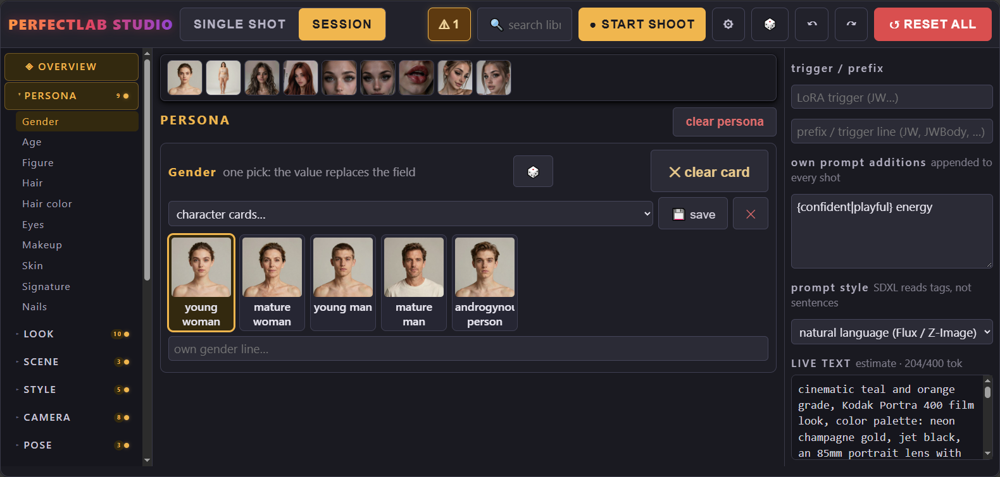</p>

- **Figure**: a 26-key set, multi-pick. Ten whole-figure builds (very
  slim to plus-size, petite to tall) and sixteen body-part keys: *a large
  or small bust, wide or narrow hips, a big or flat butt, thin or muscular
  arms, a flat or round stomach, broad shoulders, a wasp waist, a broad
  back, long or muscular legs, narrow shoulders*. Each tile focuses on
  its part, shot in plain underwear.

<p align="center">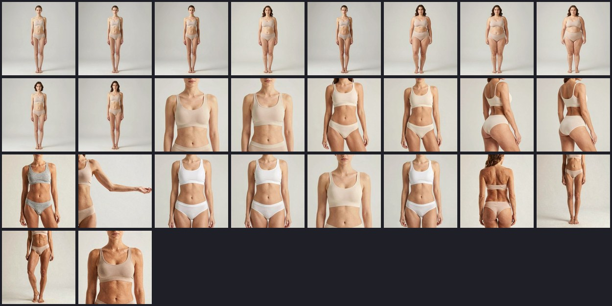</p>

- **Hair**: 30 styles from platinum waves to a pixie cut, including the
  afro-textured family (afro, box braids, cornrows, locs) and a buzz cut.

<p align="center">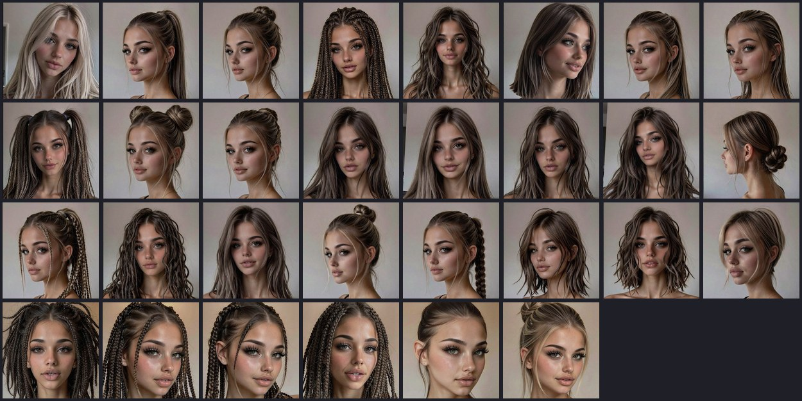</p>

<p align="center"></p>

- **Hair color**: 16 saturated carriers, one per shade.

<p align="center">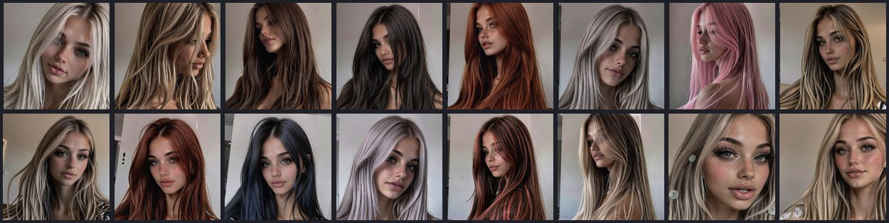</p>

- **Eyes**: 10 colors, heterochromia included.

<p align="center">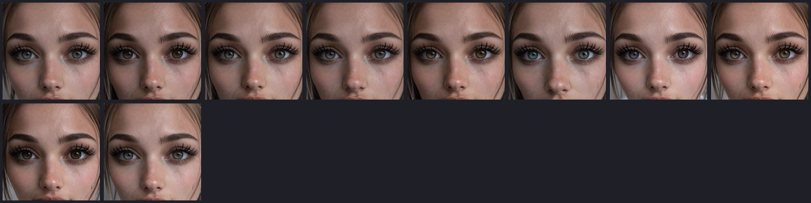</p>

- **Makeup**: 26 tiles, sorted: nine eye looks first (extreme macro on the
  eyes), then ten lip looks (one closed mouth per tile, shot as one carrier
  crop), three blush tiles, the trend wave (cold girl, siren eyes, glass
  skin, sculpted contour), then a bare face.

<p align="center">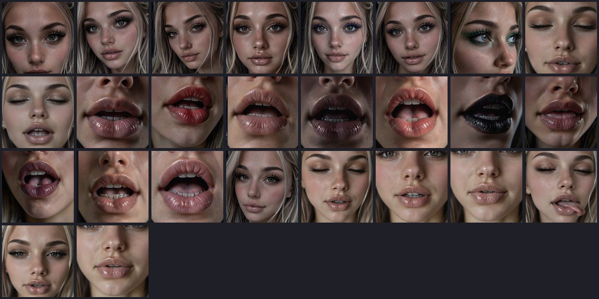</p>

<p align="center">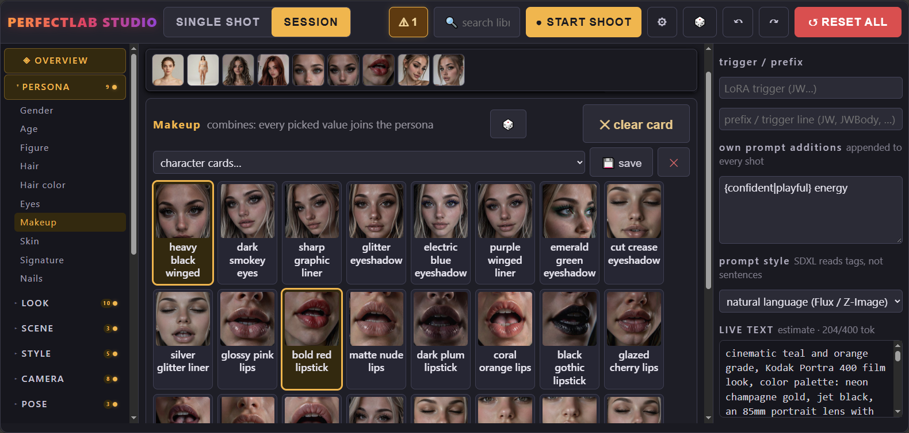</p>

- **Skin**: 10 tones, porcelain to deep ebony, plus beach tan lines and a
  body oil glow. One seed, one pose: the only difference between the tiles
  is the tone itself.
- **Signature**: 15 marks, each a tight macro on its own part of the face
  or hand: beauty marks, nose rings, scars, a gap tooth, a freckle
  constellation, a full tattoo sleeve.
- **Nails**: 8 manicures (French tips, glossy red, almond nude, chrome,
  pearl accents). They ride the hands close-ups.

<p align="center">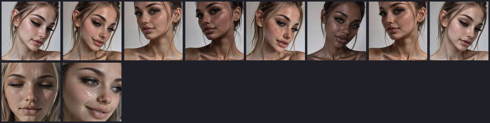&nbsp;&nbsp;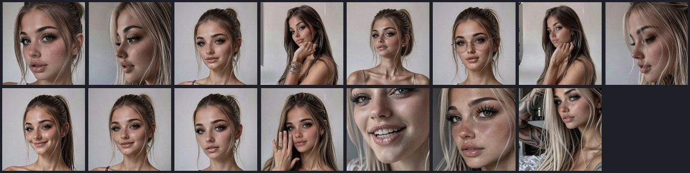</p>

<p align="center">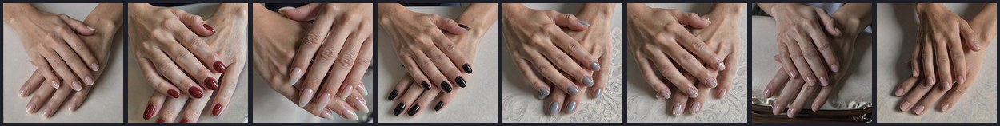</p>

## LOOK: the wardrobe, picked not typed

The top card opens with **ready-made looks**: eight curated full looks
(clean girl, y2k crop, street layer, office sharp, cozy evening, night
out, sporty set, goth edge), each styling hair, makeup and the first
look's outfit in one click. The active look highlights itself.

Six subsections: **Tops (41), Bottoms (32), Footwear (28), Headwear (13),
Lingerie (10), Accessories (36)**. Each card shows the photo grid of its
library: click a tile to pick the piece, click again to clear, and right
under it the **color swatches and material chips of that very piece**.
Colors and materials are photo swatches too: fabric close-ups for
garments, leather for shoes, woven straw for hats, metal for jewelry.

<p align="center">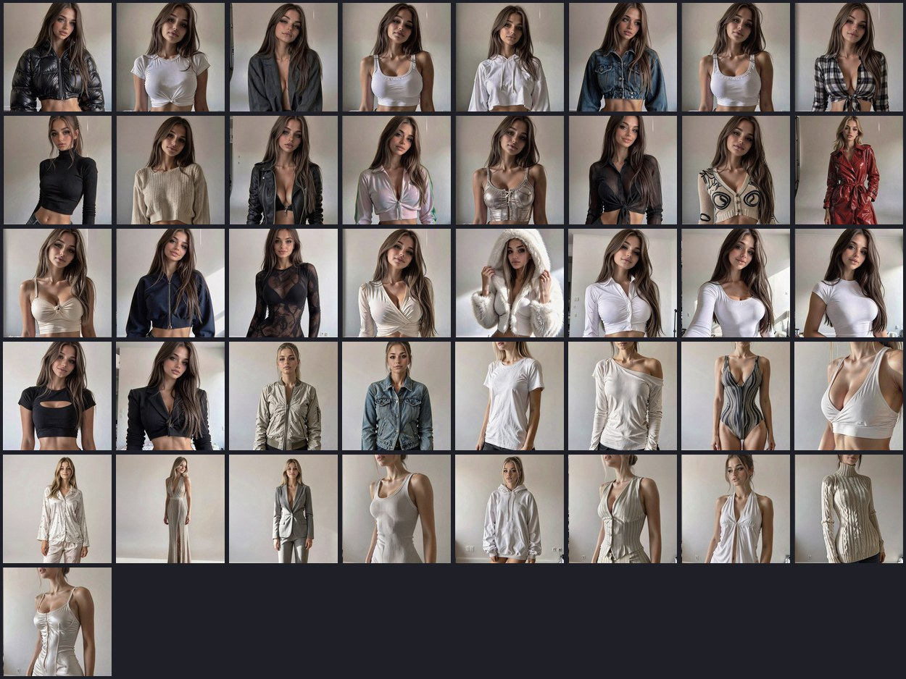</p>

<p align="center">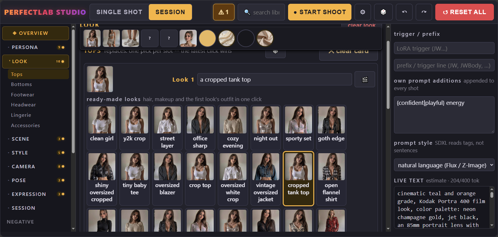</p>

<p align="center"></p>

<p align="center">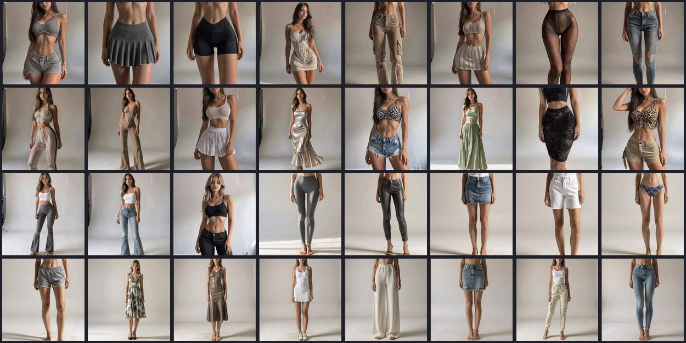</p>

<p align="center">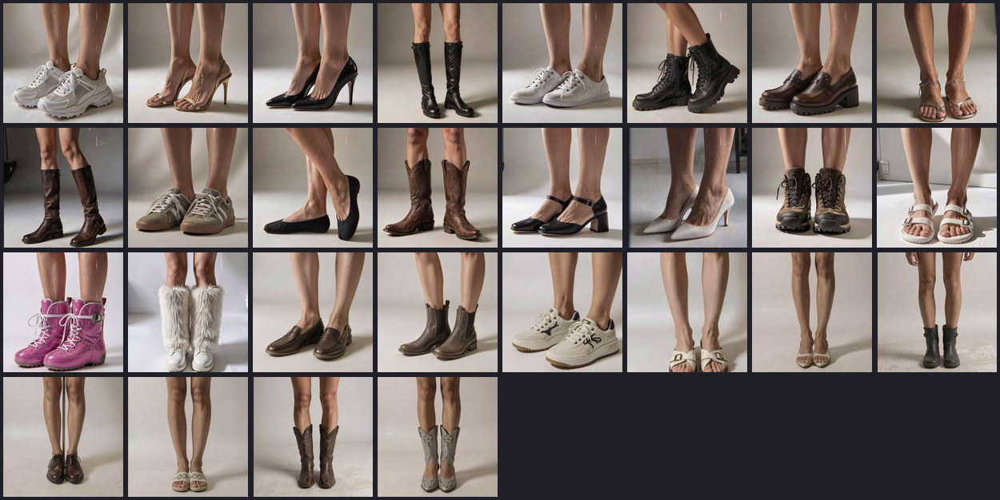</p>

<p align="center">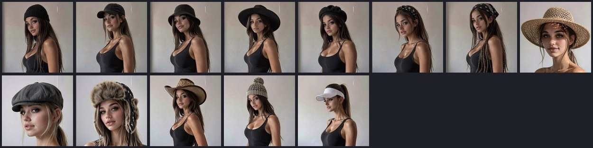</p>

**Lingerie** is its own slot: 10 sets from a lace bralette set to a silk
slip nightgown, each with color and fabric (silk, satin, lace, velvet,
mesh). The set is the whole outfit when nothing covers it; a blazer over
a lace bodysuit still reads as layering.

<p align="center">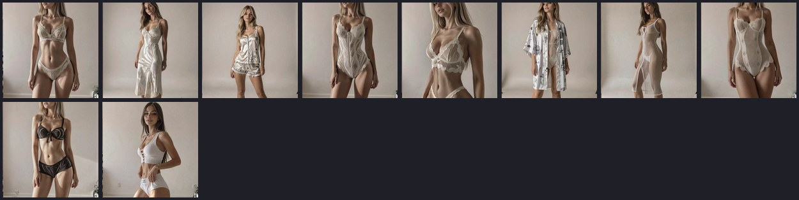</p>

<p align="center">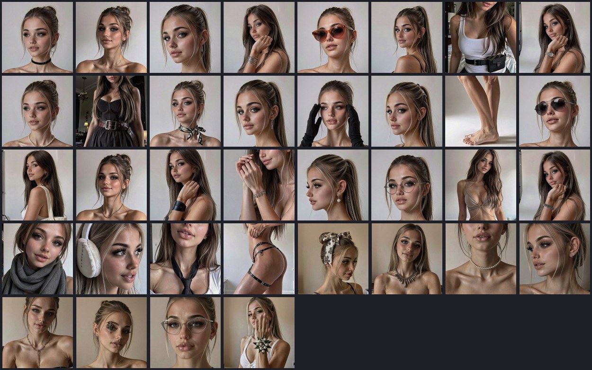</p>

**Colors & materials**: 17 garment colors, 22 material textures
(cotton to organza, plus canvas, patent leather, rubber, straw, felt and
tweed for the shoe and hat slots), 12 shoe colors, 14 hat colors, 8 jewelry
metals:

<p align="center">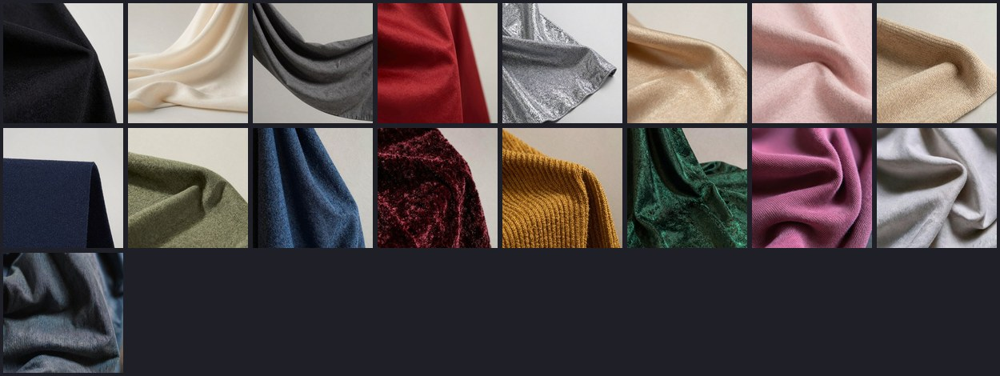</p>

<p align="center">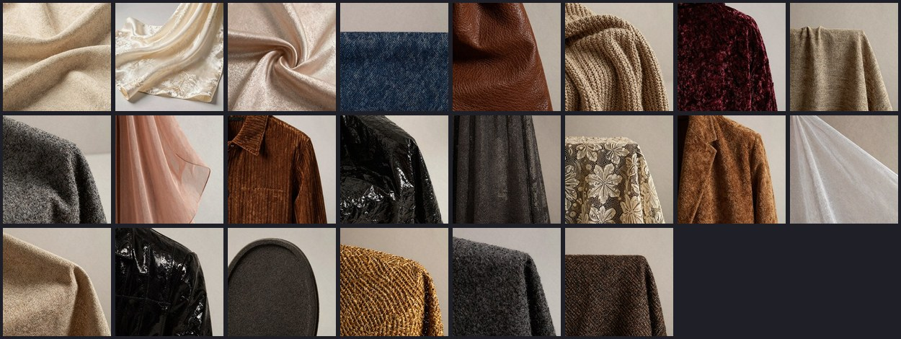</p>

<p align="center">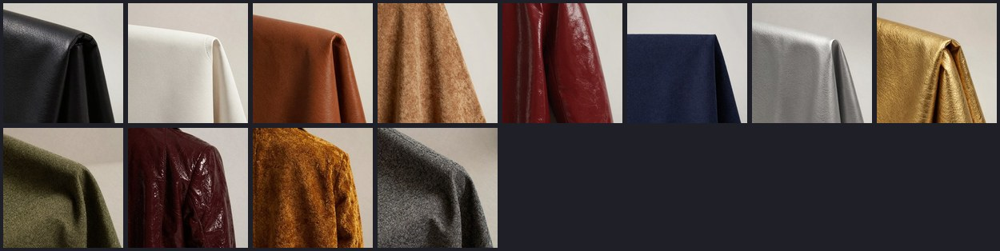&nbsp;&nbsp;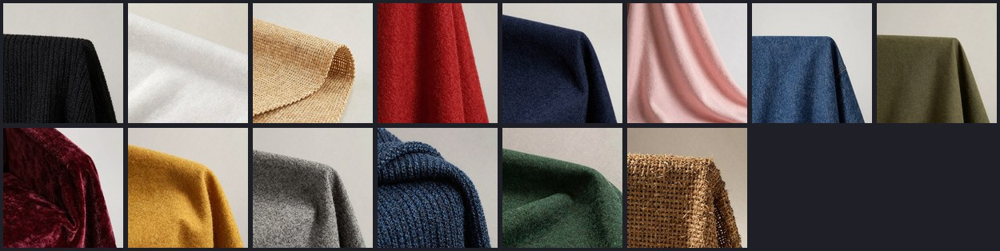</p>

A look **replaces** the whole outfit between shots; several looks walk the
session in blocks. Accessories combine, with one color for the whole set.

The **LIBRARY row** under each slot collects the pieces you typed before:
each entry keeps its preview tile (attach a photo with the 📷 button, or
shoot one through your own graph with 🎬), one click re-uses the piece,
✕ removes it from the machine.

## SCENE: where, what weather, what light

- **Location**: 65 places in three blocks (street & urban, a full home
  floor with sixteen rooms: living room fireplace, walk-in closet, vanity,
  kitchen, dining, reading nook, bedroom, bathroom, foam bathtub, home
  bar, loft, patio, and nature). The tiles are **empty scenes**: the place
  itself, no model in frame.

<p align="center">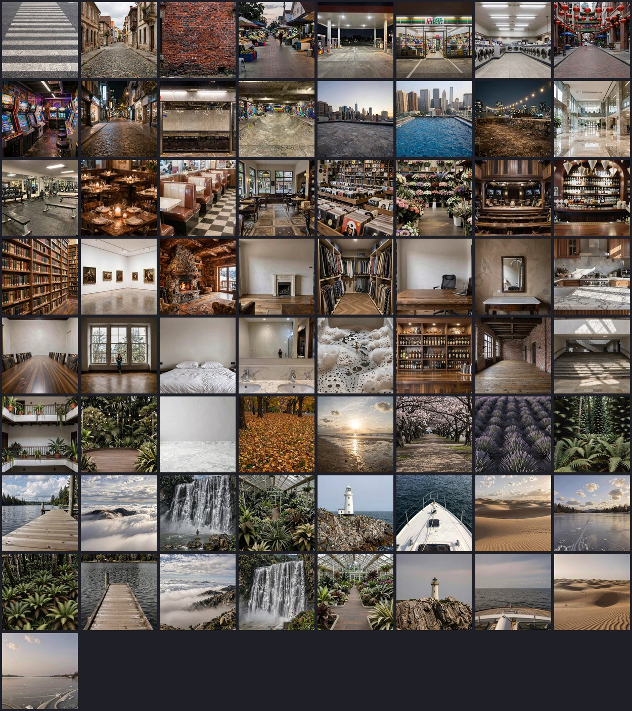</p>

- **Weather**: 12 conditions, also empty landscapes, plus in-air effects
  that work indoors too: falling petals, floating bubbles.

<p align="center">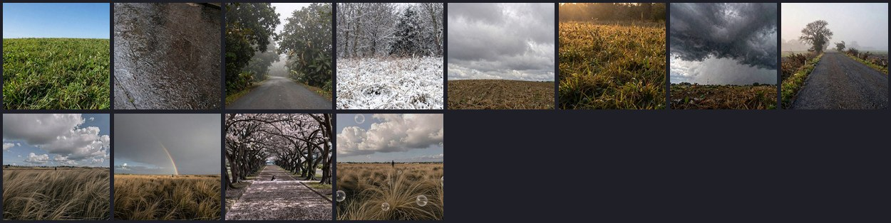</p>

<p align="center">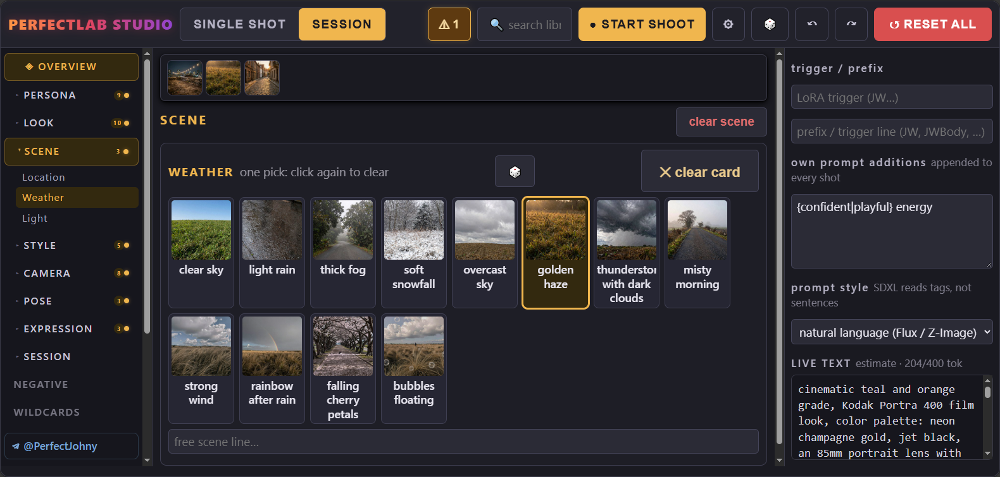</p>

- **Light**: 26 setups in five blocks: eight clock lights (dawn to neon
  night), four classic patterns (butterfly, rim, split, backlit
  silhouette, shown on a chair or a mannequin head, the subject the
  pattern needs), street sources with the lamp visible (a street lamp, a
  neon sign, car headlights), indoor sources (candlelight, a fluorescent
  office, a workshop lamp), studio & controlled (a marble studio, a tall
  window, a ring light) and the special row (moonlight, string lights, a
  stage spotlight, on-camera flash, firelight). Or set any hour from 0 to
  24 on the clock.

<p align="center">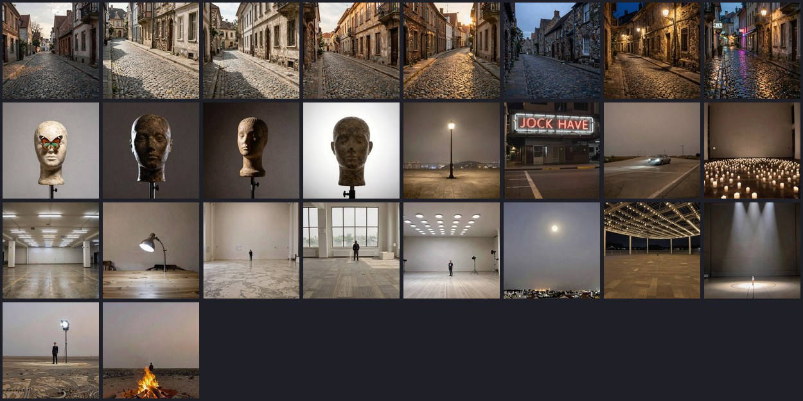</p>

- **Props**: 39 multi-pick props in four blocks: portable (a vintage
  bicycle, a motorcycle, balloons, a bouquet, a film camera, a polaroid, a
  vinyl record, a skateboard, a suitcase), everyday carry (a takeaway
  coffee cup, an ice cream cone, a slice of pizza, a disposable camera,
  dried flowers, a rolled magazine, roller skates, shopping bags, a
  cocktail glass, a hand mirror), living props (a fluffy cat in her arms,
  a small dog on a leash) and statement furniture (a grand piano, a lit
  fireplace, a chandelier, a four-poster bed, a coat rack, a wall of
  framed photos). They ride the scene line as *with a bouquet and a vinyl
  record*.

<p align="center">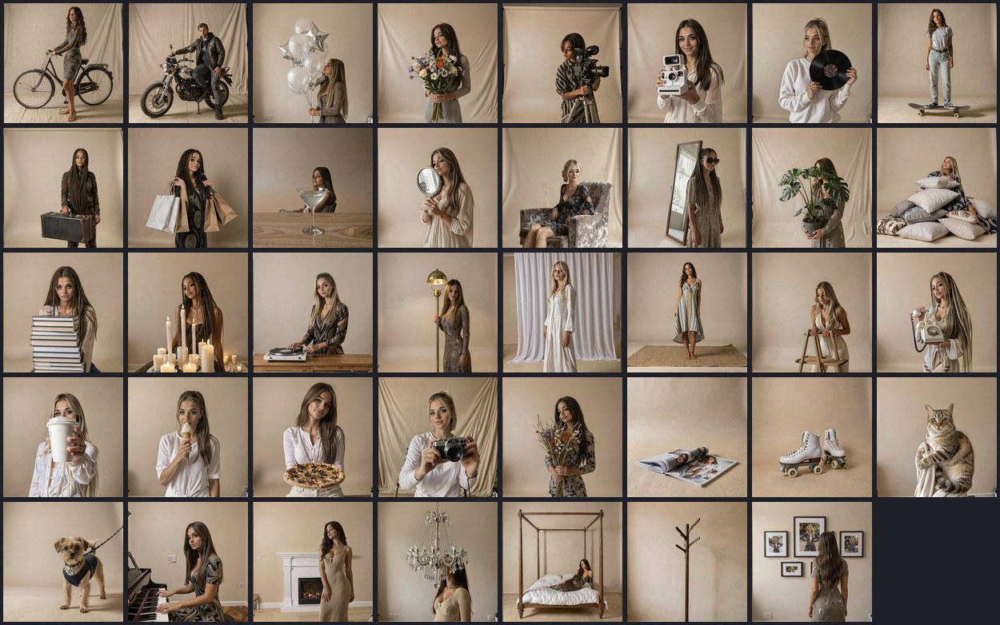</p>

One pick per group in location and light; a second click clears it.

<p align="center"></p>

## STYLE: the image-side look

**Grade**: 22 treatments from frosted y2k to clean girl, mob wife and dark
academia. **Film**: 14 stocks with their visible signatures: halation on
Cinestill, silver grain on Ilford, the white frame of a Polaroid, the
purple shift of Lomography. The **palette** row adds up to 5 color swatches
with a modifier (neon, pastel, matte, metallic, earthy).

<p align="center">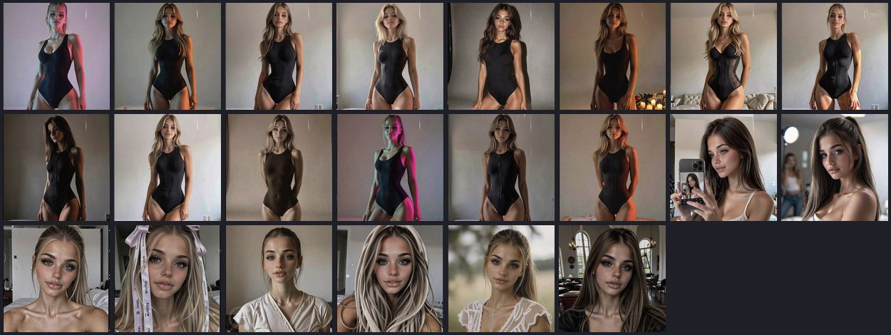</p>

<p align="center">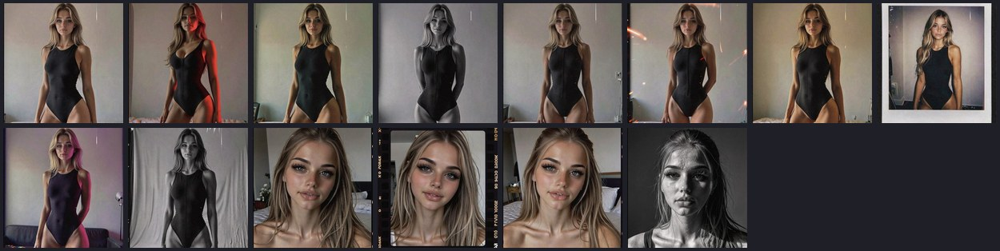</p>

<p align="center"></p>

## CAMERA: the frame

- **Framing**: 15 crops, multi-pick: the session walks the picked set
  (or opens wide and ends closest). Seven classic crops, five angles
  (profile, over-the-shoulder, low, high, dutch), a mirror shot, a top-down
  flat lay and an extreme wide establishing shot.

<p align="center">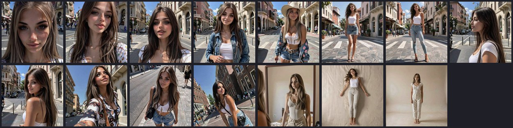</p>

- **Focus**: 14 attention points, walked per shot: face, eyes, outfit,
  hands, full figure, silhouette, background, hair, shoes, jewelry,
  profile, lips, fabric texture, a reflection in a puddle.

<p align="center">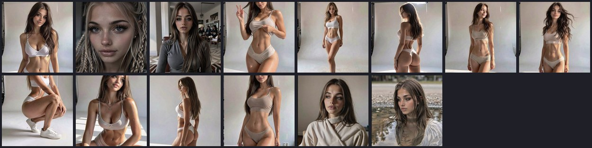</p>

- **Format**: multi-select: each frame takes the next picked aspect
  ratio; empty means follows the framing. Nine ratios from 1:1 to the
  65:24 XPan pano. The drawn ratio boxes are the preview.
- **Lens**: 6 focal lengths, each tile the look it gives: 85mm portrait
  bokeh, 50mm natural, 35mm street, 24mm wide, macro detail, tilt-shift
  miniature. One pick; the lens rides the style slot of every shot.

<p align="center">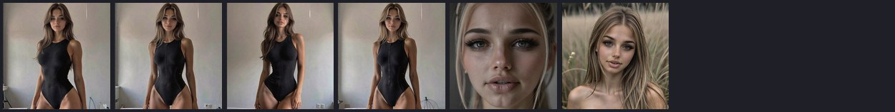</p>

<p align="center"></p>

## POSE: the 42-pose walk

Multi-pick; the picked poses ride the session in order.

<p align="center"></p>

<p align="center">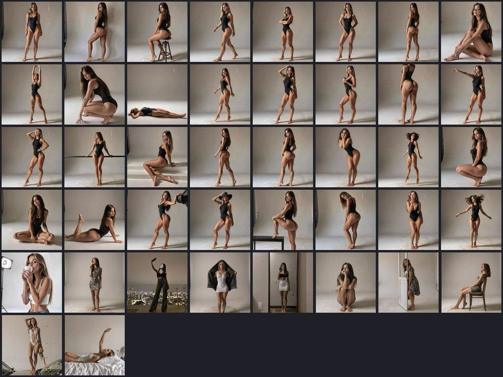</p>

## EXPRESSION: the walk

The 33-expression walk, multi-pick; the picked expressions ride the
session, one per shot.

<p align="center"></p>

<p align="center">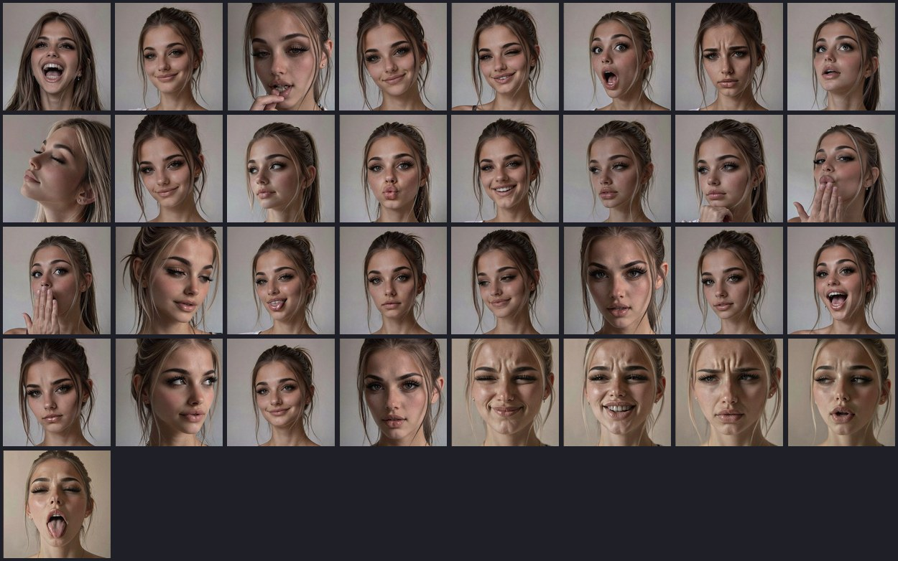</p>

## SESSION: what a run renders

The **model profile** row picks the token budget by name: Z-Image / Turbo
400, Flux.1 512, Krea 2 512, Qwen-Image 1024, SDXL 75 (which flips the
prompt to comma tags on its own) or a custom number. The linter and the
engine's guard read the same string, so the warning and the trim always
match.

The **prompt template** editor sits right under the profile: the sentence
the engine fills, with the eleven slots listed under the field
({style} {expression} {framing} {focus} {scene} {lighting} {person} {pose}
{outfit} {placement} {quality}). A custom order is one edit, the reset
button restores the stock template, and the linter flags unknown slots and
a template that lost the {person}.

Shot count (1 to 100), takes per shot (1 to 4), look rotation (blocks or
mixed), *mood on the subject line* (the expression rides the persona's
lead clause instead of standing after the crop, moods read stronger) and
*one seed for every shot* (the whole session on the same noise, a clean
A/B where only the framings, poses and looks vary). The SESSION PLAN card
in the right column summarizes the run in plain words. Every dock tile in
session mode is clickable: **re-shoot this frame** queues one fresh take
of that shot, same setup, a new roll of the seed. Every tile also carries
a ★ keeper: star the frames you keep, press the ↺ button in the dock bar,
and the panel re-shoots everything you did not star, each fresh take
landing in its own slot. The presets row next to the rail exports and
imports presets as files, so setups move between installs.

## ARCS: the session's dramaturgy

An arc gives the run an emotional curve: each shot lands at an energy 0..1
and the engine bends everything along it. Seven built-ins: *quiet to
climax*, *slow burn*, *first date*, *joy run*, *cold front*, *melancholy
fade*, *story wave*. Each also routes the expressions (the chip tooltip
shows the route). With an arc picked, five optional couplings light up:

- **takes follow the arc**: quiet shots render once, the climax gets the
  full stack (1-1-2-2-4-4 on a 6-shot climax run, not 24 frames)
- **pose follows the arc**: a dominating stance at the climax, a relaxed
  one at quiet points, swapped inside the same feed
- **placement follows the arc**: closing in vs stepping back, within the
  crop's legal set
- **crop follows the arc**: tighter at the climax, wider at quiet points
- **focus follows the arc**: the eye drawn onto the person at the
  climax, off her at quiet points

The light line always follows: intensity words read softer at quiet
points, bolder at climaxes. Every frame's META carries the arc level and
each swap. The SESSION plan prints the arc's expression route shot by
shot: chip by chip, which face each frame wears.

**Own curves**: `perfectlab_arcs.json` in the ComfyUI user folder
(`user/default/`, or `user/default/userdata/` on older builds):

```json
{ "my noir evening": { "kp": [17, 19, 24, 6, 27, 21],
                       "lv": [0.1, 0.3, 0.5, 0.7, 0.9, 1.0],
                       "note": "tired gaze to fierce glare" } }
```

`kp` are expression indexes into the 33-expression library (the route),
`lv` are energies 0..1, `note` is a tooltip. A new name joins the picker, a
built-in name is replaced. Sister files: `perfectlab_tone.json` re-tunes
how one intensity word reads at the two ends
(`{"hard lighting": ["candlelight hush", "neon glare"]}`),
`perfectlab_energy.json` re-tunes the per-pose/placement/framing/focus
energies. All re-read on change; LIVE TEXT mirrors them all.

## NEGATIVE, wildcards, the search and the linter

The NEGATIVE card carries a library of 11 common guards (deformed hands,
bad anatomy, text and watermark, blur, oversaturation, a cloned figure,
cropped limbs, jpeg artifacts, asymmetrical eyes, plastic skin, a warped
background) that toggle into the negative line next to your own words.
The header search box types across every library: match a word, see its
thumbnail, click the result and it picks into its card.

**Wildcard files**: `__name__` in any own-line resolves to a line of a
wildcard file, one phrase per line, `#` comments skip; the engine
re-reads when the file changes. Runs before `{a|b|c}` choices, so a
wildcard line may carry its own choices. Two starters ship: `__mood__`,
`__time_of_day__`. The **⁂ WILDCARDS** entry at the rail bottom is the
manager: create, edit and delete your own lists without leaving the
panel. Your files live in the profile folder (`perfectlab_wildcards/`),
survive node updates, and win over the bundled starters with the same
name.

The view group of the **⚙ settings popup** carries the preview tile
size (S / M / L / XL: fewer tiles per row at the larger steps) and the
interface scale (100 / 115 / 130%: the text and every em-sized control
grow with it), both remembered per browser. The node itself stretches
too: drag its bottom-right corner and the whole panel follows, fitting
more of the library on screen, with a comfortable minimum it never
collapses below.

The **⚙ settings button** in the header opens the settings popup in
three groups. **SEED**: the value, a 🎲 roll, and how the seed advances
between shoots (fixed, +1, or random) -- the same seed widget ComfyUI
queues, and LIVE TEXT re-rolls its wildcards with it. **VIEW**: the
preview tile size (S / M / L / XL) and the interface scale
(100 / 115 / 130%). **INTERFACE**: the language switch (EN / RU).

The **linter badge** in the header lights up when the composed prompt has
problems: token overflow against the model profile's budget, an own line
over 300 characters, a duplicated value, unbalanced braces, a choice
without `|`, a wildcard with no file, or a negative that is ON but empty.
It also lists **conflicts**: the swaps the engine would make silently. A
face focus does not survive figure-tier crops, a back-to-camera pose reads
the silhouette, a walked format feed drops the ratios the picked crops
contradict (a pinned format passes as-is, the user asked for it). Each
line names the values and the swap.

The **🎲 inspiration roll** in the header re-rolls every creative section
in one click: garments, colors, materials, accessories, location, weather,
light, props, grade, film, palette, framings, focus, poses, expressions.
The persona, the trigger, your own words, the negative, the session
settings and the output formats stay untouched, and the whole roll is one
undo step.

## How many picks is too many

Every text encoder has a fixed attention budget across the prompt. Fill
35 chips and the weight per feature collapses: the model averages
everything into a generic look, and packed words bleed into neighbors
(a red lipstick next to copper hair tints the whole face). The sweet
spot for a distinctive, reproducible person is **3 to 5 strong anchors**:
the age and build, the hair, the eyes plus one signature trait, one
simple high-contrast garment. Leave the micro-fields empty: the model
interpolates harmonious proportions around the anchors on its own. The
linter badge counts your tokens; the attention budget is the reason it
matters.

## The right column

The LoRA trigger, the prefix line, a **wide own-prompt field** appended to
every shot, the **prompt style switch** (natural language for Flux /
Z-Image, SDXL tags for tag parsers; in tag mode every multi-select
substitutes **one value per frame, rotating across the session**, and
each frame gets its own size from its format or framing), the LIVE TEXT
estimate with its token warning, and the SESSION PLAN card.
